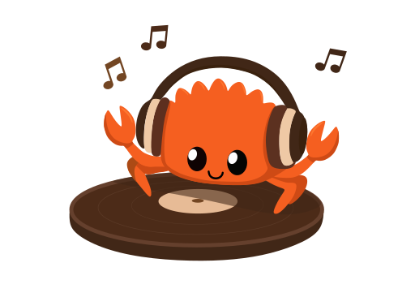

# RustMusicPlayer

    

> Self written local music player using **Rust**. 
> This project also aimed for practicing git working process.

## Libs
- **Rodio** => 0.22.2
- **Iced** => 0.14.0
- **lofty** => 0.25.1
- **reqwest** => 0.14.5
- **tokio** => 1

## Features
- [x] Track list from the folder
- [x] Downloading song from open sources
- [x] Full song control
- [ ] Advance the downloading algorithm and amount of sources

**Thank you for visiting**